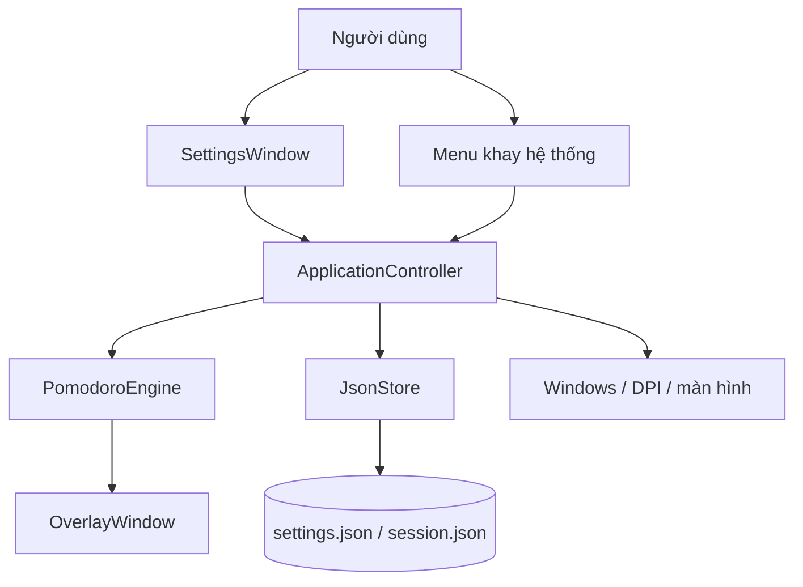

# Cấu trúc hệ thống — Nekodoro

## 1. Phạm vi MVP

Ứng dụng C# / WPF trên .NET 10 cho Windows, chạy nền ở khay hệ thống. Thanh thời gian nằm ở cạnh trên, dưới, trái hoặc phải; có thể chỉnh độ dài, độ dày, vị trí, độ trong suốt và màn hình hiển thị.

Thanh dùng màu đồng nhất, cho chọn màu riêng cho làm việc, nghỉ ngắn và nghỉ dài. Cấu hình được xem trước trực tiếp, lưu cục bộ và khôi phục khi mở lại ứng dụng.

## 2. Thành phần và luồng dữ liệu



| Thành phần | Trách nhiệm |
|---|---|
| `PomodoroEngine` | Bộ đếm đơn điệu, trạng thái, chu kỳ nghỉ và snapshot; không phụ thuộc WPF. |
| `IClock` | Đồng hồ đo thời lượng, có thể thay bằng đồng hồ giả trong kiểm thử. |
| `AppSettings` | Cấu hình Pomodoro, hình học thanh, màu từng loại phiên và hành vi ứng dụng. |
| `ColorSettings` | `FocusColor`, `ShortBreakColor`, `LongBreakColor`, kiểm tra mã màu hợp lệ. |
| `JsonStore` | Kiểm tra, chuyển đổi schema, đọc/ghi cấu hình và phiên qua file tạm. |
| `ApplicationController` | Kết nối bộ đếm, khay hệ thống, thông báo, lưu phiên, ngủ/thức và giao diện. |
| `OverlayWindow` | Vẽ rãnh nền và tiến độ, đặt vị trí thanh, nhấp xuyên qua, chỉnh vị trí. |
| `SettingsWindow` | Bản nháp cài đặt, xem trước trực tiếp, Lưu/Hủy và điều khiển phiên. |
| `FocusWindow` | Cửa sổ tập trung riêng: đồng hồ, nút theo trạng thái, mèo và chu kỳ dấu chân. |
| `MascotArt` | Nạp sprite sheet một lần, tạo sáu ảnh cắt bất biến/cache; không có vòng lặp hoạt ảnh. |
| `TrayIconService` | Sở hữu HWND riêng và icon cà chua; đăng ký trực tiếp với Windows, kiểm tra kết quả, xử lý menu và khôi phục sau khi Explorer khởi động lại. |
| `Native` | Tương tác Windows, màn hình, DPI và hành vi cửa sổ. |

MVP gom các dịch vụ Windows vào controller và lớp giao diện để giữ mã nguồn gọn; chưa cần tách ViewModel hoặc framework dependency injection.

## 3. Cấu trúc mã nguồn

```text
PomodoroTaskbar.slnx
src/
  PomodoroTaskbar.Core/
    Settings.cs
    PomodoroEngine.cs
    JsonStore.cs
  PomodoroTaskbar.Windows/
    App.xaml
    ApplicationController.cs
    OverlayWindow.cs
    SettingsWindow.cs
    FocusWindow.cs
    MascotArt.cs
    SettingsStyles.xaml
    TrayIconService.cs
    Native.cs
    Assets/
tests/
  PomodoroTaskbar.Core.Tests/   # Kiểm thử console, không cần thư viện ngoài
  PomodoroTaskbar.Windows.Tests/ # Hồi quy Lưu, đóng/mở cài đặt và đăng ký tray
artifacts/                    # Bản portable và ZIP
```

`Windows` tham chiếu `Core`; `Core` không tham chiếu WPF hay Win32.

Nhịp cập nhật giao diện là 500 ms khi bộ đếm chạy và thanh hiện, 1 giây trong các trạng thái còn lại. Hình học, HWND và màn hình được cache; thay đổi cấu hình/DPI/màn hình làm tính lại. Chỉ gọi Win32 khi vị trí hoặc chế độ nhấp xuyên qua thực sự đổi. Tiến độ cập nhật theo pixel vật lý; chữ và tooltip chỉ đổi theo giây/trạng thái. Thanh ẩn bỏ qua phần vẽ. Engine vẫn dùng đồng hồ đơn điệu nên nhịp giao diện không tích lũy sai số bộ đếm. Xem `PERFORMANCE.md` về số liệu thực tế và giới hạn đo.

## 4. Bộ đếm và vòng đời phiên

- Loại phiên: `Focus`, `ShortBreak`, `LongBreak`.
- Trạng thái: `Idle`, `Running`, `Paused`, `AwaitingNext`.
- Mặc định: làm việc 25 phút, nghỉ ngắn 5 phút, nghỉ dài 15 phút sau 4 phiên làm việc hoàn tất.
- Bỏ qua hoặc đặt lại không tăng số phiên hoàn tất. Đặt lại giữ số phiên trong chu kỳ.
- Tự động chuyển phiên mặc định tắt; khi tắt, phiên kế tiếp chờ người dùng bắt đầu.
- Thay đổi thời lượng không sửa phiên đang chạy; áp dụng khi bắt đầu hoặc đặt lại phiên.
- Đồng hồ đơn điệu đo thời gian đã trôi qua, không trừ một giây mỗi nhịp giao diện. Tiến độ bằng `remaining / duration`, giới hạn trong `[0, 1]`.
- Hoàn tất chỉ phát sự kiện một lần. Nhịp cập nhật chậm chỉ hoàn tất phiên đang hoạt động, không tự ghi nhận nhiều phiên đã qua.
- Máy ngủ sẽ tạm dừng; sau khi thức chờ tiếp tục. Mở lại ứng dụng khôi phục phiên chạy trước đó thành tạm dừng.

## 5. Thanh thời gian và màu sắc

| Thuộc tính | Giá trị |
|---|---|
| Cạnh | `Top`, `Bottom`, `Left`, `Right` |
| Độ dài | 10–100% chiều dài cạnh |
| Độ dày | 2–20 DIP |
| Căn vị trí | `Start`, `Center`, `End` |
| Khoảng cách mép | 0–30 DIP |
| Hướng thu ngắn | `FromStart`, `FromEnd`, `ToCenter` |
| Độ trong suốt | 0–1 |
| Màu | Một màu riêng cho mỗi loại phiên; mã `#RRGGBB` hoặc `#AARRGGBB` |

Rãnh nền giữ nguyên độ dài; phần màu thu ngắn theo thời gian còn lại. Mặc định cạnh trên, căn giữa, dài 60%, dày 4 DIP. Thanh không chiếm vùng bố cục và không lấy focus; mặc định nhấp xuyên qua. Chế độ chỉnh vị trí tạm cho phép kéo và căn vào cạnh.

Có lựa chọn hiện thời gian còn lại và ẩn khi ứng dụng khác toàn màn hình trên cùng màn hình. Khi tháo màn hình ưu tiên, dùng màn hình chính và giữ lựa chọn ưu tiên để khôi phục. Tính lại vị trí khi bố trí, độ phân giải hoặc DPI thay đổi; hỗ trợ tọa độ âm.

## 6. Dữ liệu cục bộ và tương thích cấu hình

Lưu tại `%LocalAppData%\PomodoroTaskbar\`: `settings.json`, `session.json` và log chẩn đoán có giới hạn dung lượng.

Cấu hình hiện tại dùng `schemaVersion: 2`, gồm `pomodoro`, `overlay`, `colors`, `notificationsEnabled`, `soundEnabled`, `launchAtStartup`. `colors` chứa ba trường `focusColor`, `shortBreakColor`, `longBreakColor`.

Khi đọc cấu hình v1, chuyển ba màu đã lưu sang `colors` và giữ nguyên tùy chọn bộ đếm, thanh, thông báo, khởi động. Các lựa chọn hiệu ứng cũ bị bỏ qua. Lần lưu tiếp theo ghi schema v2. Phiên bản chưa hỗ trợ hoặc dữ liệu sai được sao lưu rồi dùng mặc định.

Ghi file qua file tạm rồi thay thế. Phiên lưu sau lệnh, chuyển trạng thái, ngủ/thoát và khoảng mỗi 10 giây khi chạy. Nếu tiến trình bị kết thúc đột ngột, có thể mất tối đa khoảng lưu định kỳ. Tác vụ ghi chạy ngoài luồng giao diện và được tuần tự hóa.

## 7. Giao diện và tích hợp Windows

Thay đổi cài đặt dùng bản nháp để xem trước vị trí, kích thước và màu. Lưu kiểm tra và áp dụng, hiện xác nhận và giữ cửa sổ mở. Cấu hình đã lưu được sao chép riêng khỏi bản nháp; Hủy hoặc đóng cửa sổ chỉ bỏ các thay đổi chưa lưu.

Menu khay hỗ trợ bắt đầu, tạm dừng, tiếp tục, bỏ qua, đặt lại, cài đặt và thoát. Đóng cài đặt đưa ứng dụng về khay; lệnh Thoát lưu phiên và giải phóng tài nguyên. Chỉ chạy một phiên bản ứng dụng. Thông báo và âm báo có thể bật/tắt riêng; lỗi thông báo không làm dừng bộ đếm. Khởi động cùng Windows mặc định tắt.

Nekodoro mở `FocusWindow` khi khởi động hoặc nhấp tray; cài đặt là cửa sổ riêng với bốn tab Nhịp/Thanh/Màu/Ứng dụng. Nhấp trái tray hoặc chạy EXE lần nữa mở cửa sổ tập trung. Cả hai cửa sổ dùng cùng một engine và cùng cơ chế đóng về tray. Assembly/EXE là `Nekodoro`, namespace và dữ liệu/định danh cũ được giữ để tương thích. Khởi động cùng Windows sửa đường dẫn EXE khi cần.

Tray dùng GUID ổn định và icon riêng; kết quả `Shell_NotifyIcon` được kiểm tra. Nếu đăng ký thất bại, không cho đóng cửa sổ cài đặt để tránh mất đường điều khiển. Windows có thể đặt icon trong vùng `^`; ứng dụng không thay đổi lựa chọn ghim biểu tượng của hệ điều hành. Lần mở EXE tiếp theo gửi tín hiệu qua named event để mở lại cửa sổ của tiến trình đang chạy. Vòng đời ứng dụng dùng `OnExplicitShutdown`.

## 8. Kiểm chứng và phần còn lại

Kiểm thử Core bao gồm chu kỳ nghỉ, tạm dừng, nhịp trễ, đầu vào sai, khôi phục phiên, lưu màu và chuyển đổi cấu hình cũ. Đã kiểm tra mở ứng dụng và thao tác Bắt đầu/Tạm dừng trên desktop.

Cần tiếp tục kiểm chứng đầy đủ bốn cạnh, nhiều màn hình/DPI, nhấp xuyên qua, ngủ/thức, toàn màn hình, thông báo, khởi động cùng Windows và bản portable trên máy khác. Xem `TODO.md` và `README.md` về tiến độ, lệnh chạy và giới hạn.

Ngoài MVP: thống kê, danh sách công việc và đồng bộ nếu có nhu cầu.
